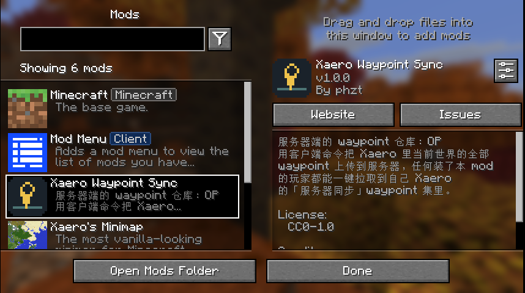
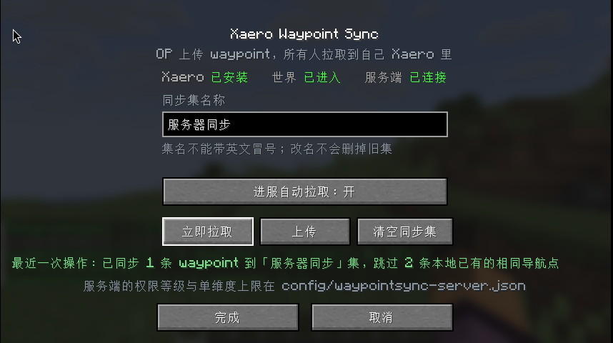

# Xaero Waypoint Sync

把 OP 在 Xaero 里建的 waypoint 变成全服共享的一份数据。

- **OP** 在游戏里执行 `/wpsync upload`：把当前服务器**所有维度**的 Xaero waypoint 打包上传；
- 服务端存一份（`<存档>/waypointsync/waypoints.json`），权限只有 OP；
- **任何装了本 mod 的玩家** 执行 `/wpsync pull`，waypoint 会写进自己 Xaero 的「服务器同步」集里
  （默认进服自动拉一次）；
- 集名和自动拉取这些开关都在**设置页**里：装了 Mod Menu 就从 mods 列表点本 mod 的齿轮，
  没装 Mod Menu 就 `/wpsync config`。

本 mod 是双端 jar：服务端负责存储、权限、下发；客户端负责读写 Xaero。只装服务端也能启动，
只是没人能上传/拉取。

## 环境

| 项 | 版本 |
|---|---|
| Minecraft | 26.3 |
| Fabric Loader | 0.19.5 |
| Fabric API | 0.162.0+26.3 |
| 客户端前置 | Xaero's Minimap ≥ 26.6.1（waypoint 本体），Xaero's World Map 可选 |
| 客户端可选 | Mod Menu ≥ 21.0.0（只为在 mods 列表里给出本 mod 的设置入口） |

## 命令

### 客户端（`/wpsync`）

| 命令 | 作用 |
|---|---|
| `/wpsync upload` | 收集当前服务器所有维度的 waypoint，分片上传给服务端（服务端再校验 OP 权限） |
| `/wpsync pull` | 请求服务端数据，写进本地「服务器同步」集 |
| `/wpsync info` | 看 Xaero 是否在位、当前集名、本地可上传条数 |
| `/wpsync clear` | 清掉本地「服务器同步」集 |
| `/wpsync config` | 打开设置页（集名、进服自动拉取、三个动作按钮） |

### 服务端（`/wpsyncadmin`，需要 OP）

| 命令 | 作用 |
|---|---|
| `/wpsyncadmin info` | 仓库概览（维度数 / 总条数 / 权限等级 / 单维度上限） |
| `/wpsyncadmin list` | 每个维度的条数、上传者、更新时间 |
| `/wpsyncadmin clear <维度\|all>` | 清空某个维度或全部 |
| `/wpsyncadmin reload` | 重读磁盘上的仓库与 `config/waypointsync-server.json` |

服务端命令故意不叫 `/wpsync`：单人游戏里同名命令会互相抢输入。

## 设置界面

装了 Mod Menu 时，mods 列表里本 mod 那一项长这样：选中它，点右上角的齿轮。



设置页本身：



| 控件 | 作用 |
|---|---|
| 同步集名称 | 拉取写进哪个集。不能含英文冒号（Xaero 用 `:` 分字段）、不能以 `gui.xaero` 开头（那是 Xaero 的内置集）、最多 32 字符；**改名不会自动删掉旧集** |
| 进服自动拉取：开/关 | 进服务器两秒后自动拉一次，免得每次手动敲命令 |
| 立即拉取 / 上传 / 清空同步集 | 三个命令的按钮版。上传仍由服务端校验 OP；清空要**连点两次**才执行，5 秒内不确认就自动复原 |
| 完成 / 取消 | 完成才写 `config/waypointsync-client.json`；取消丢弃改动 |

页面顶部一行是实时状态（Xaero 装了没、世界进了没、服务端握手了没），底部一行是最近一次操作的回执——
界面打开时聊天栏是看不见的，所以回执在这里再显示一遍。

入口有两个：装了 Mod Menu 就在 mods 列表里点本 mod 的齿轮（`fabric.mod.json` 的 `modmenu` entrypoint，
Mod Menu 只在编译期依赖，没装也不影响启动）；没装 Mod Menu 就 `/wpsync config`。

服务端那份配置没有界面（专用服务器上没有客户端屏），仍然是 `config/waypointsync-server.json`
加 `/wpsyncadmin reload`。

## 配置

服务端 `config/waypointsync-server.json`：

```json
{
  "opPermissionLevel": 2,
  "allowNonOpUpload": false,
  "maxWaypointsPerDimension": 4000,
  "maxDimensions": 64
}
```

客户端 `config/waypointsync-client.json`：

```json
{
  "setName": "服务器同步",
  "autoPullOnJoin": true
}
```

## 数据长什么样

`<存档>/waypointsync/waypoints.json`：

```json
{
  "version": 1,
  "dimensions": {
    "minecraft:overworld": {
      "uploader": "Steve",
      "updatedAt": 1792411591501,
      "waypoints": [
        {
          "name": "主基地", "initials": "主",
          "x": 128, "y": 64, "z": -256,
          "color": 13, "yaw": 0, "rotation": false,
          "yIncluded": true, "disabled": false,
          "set": "服务器", "dimension": "minecraft:overworld"
        }
      ]
    }
  }
}
```

上传是**整批覆盖**：这次的维度集合就是全部，没上传的维度会被删掉。这样不会出现「旧数据+新数据」
拼在一起的半吊子状态，也和「OP 把当前世界整个推上来」的语义一致。

## 几个设计取舍

**为什么写进专用集，而不是只读注入层。**
Xaero 有第三方 waypoint 注入接口（`ThirdPartyWaypoints`），但它不落盘、重连就没了，
而且传送/编辑都不是正常路径。写进一个专用集（默认「服务器同步」）之后，world map、小地图、
waypoint 列表、传送全都照常，玩家也能一眼分清哪些是服务器给的。代价是会在 Xaero 的
`waypoints.txt` 里多一个集——每次拉取整集重写，不碰玩家自己的集。

**为什么服务端不解析 Xaero 文件。**
waypoint 存在客户端，服务端拿不到；Xaero 的文件格式也没有对外承诺稳定。所以上传由客户端
按 Xaero 自己的 API 读出来，服务端只认本 mod 的 JSON 记录，Xaero 升级不会波及存档格式。

**为什么分片。**
一条 waypoint 序列化后几十到几百字节，几千条会超过单包上限。上传/下发都按 18KB 左右切 JSON
数组，每片带 `part/total`，收齐再处理。

## 构建

```sh
./tools/fetch-libs.sh   # 拉 Xaero 与 Mod Menu 的 jar 到 libs/（许可原因不进仓库）
./gradlew25 build       # 不要直接用 ./gradlew，见 gradle.properties 注释
```

产物：`build/libs/xaero-waypoint-sync-1.0.0.jar`。

## 已知限制

- 拉取只写「当前服务器容器里已经存在的维度」。没去过的维度 Xaero 本地还没有对应世界，跳过。
- 拉取时会先扫这个维度里玩家**自己**的 waypoint：名字 + 坐标完全相同的，跳过不加进同步集
  （颜色/朝向不算差异）。同步集本身每次整集重写，不受这条影响。
- 上传会覆盖服务端整份数据（这是故意的）；要保留多份请用 `/wpsyncadmin list` 先备份
  `waypoints.json`。
- 没装本 mod 的客户端收不到数据（原版 Xaero 没有服务端推送 waypoint 的通道）。
- 名字超 32 字符、图标缩写超 4 字符会被服务端截断，坐标会被夹到 ±30M。
